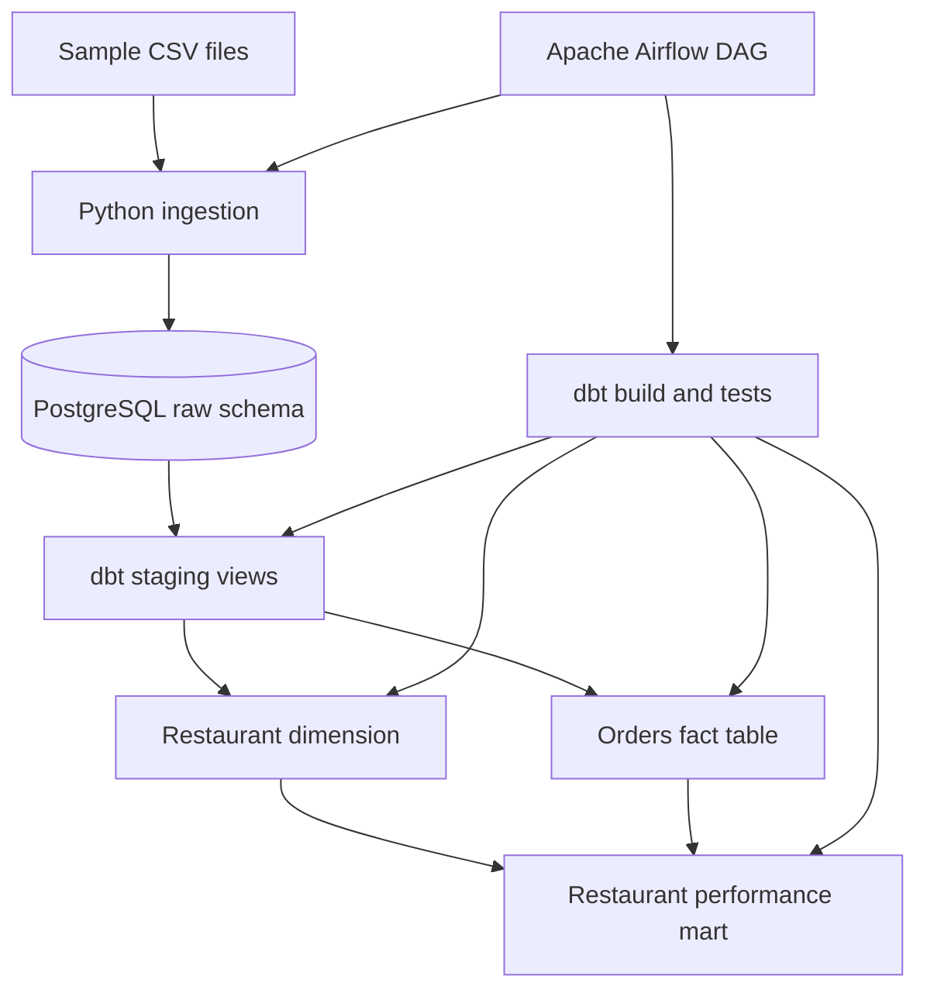

# Restaurant Analytics Data Pipeline

[](https://www.python.org/)
[](https://www.postgresql.org/)
[](https://www.getdbt.com/)
[](https://airflow.apache.org/)
[](https://docs.docker.com/compose/)

A local-first data engineering portfolio project that ingests synthetic restaurant, order, and review CSV data into PostgreSQL, transforms it with dbt, and orchestrates the workflow with Apache Airflow.

> **Project status:** The source code, sample data, Docker Compose configuration, Airflow DAG, and dbt models are committed to this repository. The end-to-end pipeline has  been verified successfully , so the instructions below describe how to configure and test it rather than claiming a successful production run.

## Project overview

The pipeline is designed to demonstrate a typical local data engineering workflow:

1. Read and validate CSV files using Python.
2. Load records into PostgreSQL raw tables using transactional writes and upserts.
3. Transform raw data through dbt staging models and analytical models.
4. Run dbt model tests.
5. Use Airflow to orchestrate ingestion followed by the dbt build.

The data is synthetic and intended for learning and portfolio demonstration. This project does not connect to Zomato's internal systems or use real customer data.

## Architecture



## Technology stack

| Technology | Purpose |
|---|---|
| Python 3.12 | CSV parsing, validation, and ingestion |
| PostgreSQL 16 | Relational storage for raw and transformed data |
| dbt with dbt-postgres | SQL transformations and data tests |
| Apache Airflow | Task orchestration, retries, and execution history |
| Docker Compose | Local service configuration and startup |
| Git and GitHub | Version control and project sharing |

## Repository structure

```text
.
├── airflow/
│   ├── Dockerfile
│   ├── requirements.txt
│   └── dags/
│       └── zomato_pipeline.py
├── data/
│   ├── generate_sample_data.py
│   ├── orders.csv
│   ├── restaurants.csv
│   └── reviews.csv
├── dbt_project/
│   ├── dbt_project.yml
│   ├── profiles.yml
│   ├── macros/
│   └── models/
│       ├── staging/
│       ├── marts/
│       └── schema.yml
├── ingestion/
│   ├── load_csv.py
│   └── requirements.txt
├── .env.example
├── .gitignore
├── docker-compose.yml
└── requirements.txt
```

## Pipeline components

### 1. Python ingestion

`ingestion/load_csv.py` reads the restaurant, order, and review CSV files. It checks the expected column headers, converts values to their expected types, creates the `raw` schema and tables if needed, and upserts records using stable primary keys. Database writes are handled in a transaction; an ingestion error triggers rollback.

The default local data directory is the repository's `data/` folder. Inside the Airflow container, the DAG sets `ZOMATO_DATA_DIR=/opt/data`.

### 2. PostgreSQL

The Compose configuration defines a PostgreSQL 16 service with a health check and a named `postgres_data` volume. The ingestion code creates these raw tables:

- `raw.restaurants`
- `raw.orders`
- `raw.reviews`

The named volume is intended to preserve database files when containers are stopped and recreated. Avoid `docker compose down -v` unless you intentionally want to delete the database volume.

### 3. dbt transformations

The dbt project includes staging models and analytical models:

- `stg_restaurants`, `stg_orders`, and `stg_reviews`
- `dim_restaurants`
- `fct_orders`
- `analytics_restaurant_performance`

The dbt schema tests specify checks such as uniqueness, non-null values, and relationships. The Airflow DAG invokes `dbt build`, which runs applicable model builds and tests.

### 4. Airflow orchestration

The DAG ID is `zomato_local_elt`. It defines two tasks:

1. `ingest_csv_to_raw` — runs the Python ingestion script.
2. `dbt_build_and_test` — runs `dbt build` after ingestion succeeds.

The DAG has no automatic schedule (`schedule=None`) and is configured to be paused when first created. After setup, open the Airflow UI and trigger the DAG manually. Retries are configured for task failures.

## Prerequisites

- Git
- Docker Desktop with the **Linux container engine** running
- Docker Compose v2
- Windows PowerShell (the commands below use PowerShell syntax)

Python is useful for local development and sample-data generation. The main services and their Python dependencies are configured to run in Docker.

## Getting started

### 1. Clone the repository

```powershell
git clone https://github.com/kavin05-tech/Restaurant-Analytics-Data-Pipeline.git
Set-Location Restaurant-Analytics-Data-Pipeline
```

### 2. Configure local environment variables

```powershell
Copy-Item .env.example .env
```

Open `.env` and replace placeholder values, especially `POSTGRES_PASSWORD`, `AIRFLOW_ADMIN_PASSWORD`, and `AIRFLOW_SECRET_KEY`. Use values suitable for your local environment. Keep `.env` private; only the placeholder template `.env.example` should be committed.

### 3. Validate the Compose configuration

Ensure Docker Desktop is running, then execute:

```powershell
docker compose config --quiet
docker compose config --services
```

The services expected from the Compose file are `postgres`, `airflow-init`, and `airflow`. The first command should return no output when the configuration parses successfully; the second lists the configured services.

### 4. Build and start the services

```powershell
docker compose up -d --build
docker compose ps
```

The first build may take several minutes. Check the service state before continuing. If startup fails, inspect logs:

```powershell
docker compose logs --tail=100 postgres
docker compose logs --tail=150 airflow-init
docker compose logs --tail=150 airflow
```

### 5. Open Airflow

When the Airflow webserver is running, visit [http://localhost:8080](http://localhost:8080). Sign in using the local username and password configured in `.env` (the username defaults to `admin`).

Find the `zomato_local_elt` DAG. If it is paused, unpause it and trigger a run manually. Check the task logs and confirm both `ingest_csv_to_raw` and `dbt_build_and_test` succeed. The application is considered verified only after these tasks complete successfully and the database outputs have been inspected.

### 6. Stop the services

```powershell
docker compose down
```

This stops and removes the containers and network but normally preserves the named PostgreSQL volume. Do not add `-v` unless you intentionally want to remove persisted database data.

## Example analytics questions

The analytics model is intended to help explore questions such as:

- Which restaurants have the highest delivered revenue?
- How many orders does each restaurant receive?
- How do ratings compare across restaurants?
- Which restaurants combine high order volume with lower customer ratings?

Use the SQL models and resulting tables to validate the precise definitions of each metric before presenting results.

## Current validation status

- [x] Source folders, Python ingestion, Airflow DAG, dbt models, and sample CSV files committed.
- [x] GitHub repository updated with source code and documentation.
- [x] Docker Compose YAML duplicate-volume declaration corrected in the repository.
- [ ] Validate Compose configuration on a clean local checkout.
- [ ] Start PostgreSQL and Airflow successfully in Docker.
- [ ] Run the `zomato_local_elt` DAG end to end.
- [ ] Verify dbt tests and query the resulting analytics model.

This checklist should be updated as each validation step is completed.

## Security notes

- Do not commit `.env` or real credentials.
- Keep `.env.example` limited to placeholders.
- Do not publish database dumps or real customer information.
- If a credential has ever been committed to Git history, rotate it; deleting it from the latest version alone does not remove it from earlier commits.

## Author

**[kavin05-tech](https://github.com/kavin05-tech)**

Built as a learning project focused on Python, SQL, PostgreSQL, dbt, Apache Airflow, Docker Compose, dimensional modeling, and data quality.
