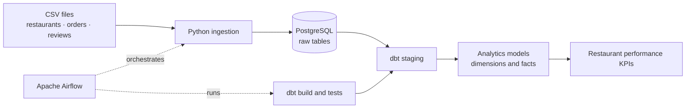

# Restaurant Analytics Data Pipeline

[](https://www.python.org/)
[](https://www.postgresql.org/)
[](https://www.getdbt.com/)
[](https://airflow.apache.org/)
[](https://docs.docker.com/compose/)

A local-first portfolio project exploring how restaurant operations data can be ingested, stored, transformed, tested, and prepared for analytics using a modern data engineering stack.

> **Repository status — implementation incomplete:** The current `main` branch includes project documentation and Docker Compose configuration, but the source directories referenced by the configuration are not yet committed. A fresh clone is therefore **not runnable yet**. This README distinguishes the intended design from verified repository contents.

## Project at a glance

- **Use case:** turn restaurant, order, and review records into analytics-ready datasets.
- **Core stack:** Python, PostgreSQL, dbt, Apache Airflow, and Docker Compose.
- **Development approach:** local-first and cloud-cost-free; synthetic sample data is planned.
- **Focus areas:** ingestion validation, reliable database writes, dimensional modeling, orchestration, and data quality.

## Intended architecture



The diagram describes the **planned workflow**, not a claim that the complete pipeline currently runs from a fresh clone.

## Technology choices

| Component | Responsibility |
|---|---|
| Python | Read source CSVs, validate fields, parse values, and load records |
| PostgreSQL | Store source-shaped records and relational analytics data |
| dbt | Express transformations as version-controlled SQL models and run data tests |
| Apache Airflow | Define task dependencies, retries, scheduling, and run visibility |
| Docker Compose | Run the local services with repeatable configuration |

## Planned data layers

1. **Raw:** source-shaped restaurant, order, and review records.
2. **Staging:** standardized names, types, and values.
3. **Dimensional models:** a restaurant dimension and an order fact table.
4. **Analytics mart:** restaurant-level metrics such as order volume, delivered revenue, and ratings.

The sample-data plan uses synthetic records only. It is intended for development and does not represent real customer or restaurant business data.

## Data engineering practices targeted

The implementation is intended to demonstrate the following practices; verify them against the source code once it is committed:

- Validate source headers and values before loading.
- Use parameterized SQL and transactions, with rollback on failed loads.
- Use stable identifiers and upserts to support safe reruns.
- Test model uniqueness, required fields, and relationships in dbt.
- Orchestrate ingestion and transformations with explicit Airflow dependencies and retries.
- Keep credentials and generated artifacts out of version control.

## Repository layout

The following is the **target layout**. Some directories shown here are referenced by `docker-compose.yml` but are currently absent from the published branch.

```text
.
├── airflow/
│   ├── Dockerfile
│   └── dags/
├── data/                    # synthetic CSV fixtures
├── dbt_project/
│   ├── models/
│   └── profiles.yml
├── ingestion/               # Python loader and dependencies
├── .env.example             # safe configuration template
├── .gitignore
├── docker-compose.yml
├── requirements.txt
└── README.md
```

## Getting started

### Prerequisites

- Git
- Docker Desktop with Docker Compose v2
- Python 3.12, if using local data-generation or ingestion commands

### 1. Clone and configure

```powershell
git clone https://github.com/kavin05-tech/Restaurant-Analytics-Data-Pipeline.git
Set-Location Restaurant-Analytics-Data-Pipeline
Copy-Item .env.example .env
```

Edit `.env` and replace every placeholder with local-only values. **Never commit `.env` or publish its credentials.** Keep `.env.example` limited to safe placeholder values.

### 2. Check the Compose configuration

After the missing source directories and files have been added:

```powershell
docker compose config --quiet
docker compose up --build -d
docker compose ps
```

These commands are documented for the intended setup; the current repository is not yet complete enough for a successful fresh-clone startup.

### 3. Open Airflow and inspect results

When the Airflow service is running, open [http://localhost:8080](http://localhost:8080) and sign in with the local credentials configured in `.env`. Confirm the DAG name in the Airflow UI before triggering it.

After ingestion and dbt complete successfully, query PostgreSQL to inspect the raw tables and analytics models. Model names and SQL examples should be documented here once the implementation is committed.

### 4. Stop the services safely

```powershell
docker compose down
```

The Compose configuration uses a named PostgreSQL volume intended to preserve database state. Avoid `docker compose down -v` unless you intentionally want to delete that volume and its data.

## Example analytics questions

The planned analytics mart should help answer questions such as:

- Which restaurants have the highest delivered revenue?
- How does order volume vary by restaurant?
- How do customer ratings compare across restaurants?
- Which restaurants have high order volume but relatively low ratings?

## Roadmap

- [ ] Commit the ingestion source, Airflow DAG, dbt models, and referenced configuration files.
- [ ] Make a fresh-clone setup work end to end and document tested commands.
- [ ] Add automated tests for ingestion validation and transformation logic.
- [ ] Include a data dictionary and representative KPI SQL queries.
- [ ] Add genuine screenshots or sample query output after a successful local run.

## Author

**[kavin05-tech](https://github.com/kavin05-tech)**

Built as a learning and portfolio project focused on Python, SQL, PostgreSQL, dbt, Airflow, Docker, data modeling, and data quality.

---

If you find an issue or have a suggestion, feel free to open a GitHub issue.
